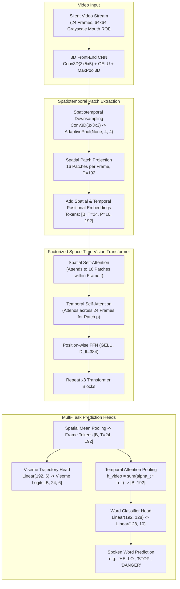

# Project 95: Lip Reading from Silent Video using Vision Transformers

[](https://pytorch.org/)
[](https://pytorch.org/)
[]()
[]()
[](LICENSE)

An end-to-end deep learning system for **Visual Speech Recognition (VSR)** that deciphers spoken words solely by analyzing the silent video frames of a speaker's mouth region without any acoustic audio stream. The architecture unites a 3D Convolutional spatiotemporal front-end with a Factorized Space-Time Vision Transformer (ViT) and multi-task supervision for word and viseme trajectory classification.

---

## Overview & Physical Motivation

Human speech communication is inherently bimodal: acoustic waveforms are accompanied by visible muscular movements of the oral vocal tract (lips, jaw, teeth, tongue). In environments characterized by extreme acoustic noise, acoustic jamming, security surveillance, or for individuals with vocal cord impairments, **silent lip reading** provides an essential channel for natural language recovery.

### The Phoneme-to-Viseme Ambiguity Challenge
While spoken English contains approximately 44 acoustic **phonemes**, the human visual vocal tract displays only 12 to 16 visually distinguishable mouth postures, called **visemes**:
- **Bilabial Stops** (`/p/`, `/b/`, `/m/`): All require total mouth closure.
- **Labiodentals** (`/f/`, `/v/`): Upper incisors contact the lower lip.
- **Alveolars / Dentals** (`/t/`, `/d/`, `/s/`, `/z/`, `/th/`): Incisors meet with tongue constriction.
- **Velars** (`/k/`, `/g/`): Articulated in the posterior oral cavity with visually ambiguous mouth openings.

Because single static frames are visually degenerate, visual speech recognition fundamentally demands **spatiotemporal trajectory modeling**: the neural network must track coarticulation dynamics, transition velocities, and aperture changes over time.

---

## System Architecture



---

## Mathematical Formulation

### 1. Spatiotemporal Front-End Convolution
Given a silent mouth video tensor $\mathbf{X} \in \mathbb{R}^{B \times 1 \times T \times H \times W}$, a 3D convolution extracts spatiotemporal feature representations over local temporal windows:
$$\mathbf{F}_{c, t, y, x} = \text{GELU}\left(\sum_{k=1}^{C_{\text{in}}} \sum_{i=-1}^1 \sum_{j=-2}^2 \sum_{l=-2}^2 \mathbf{W}_{c, k, i, j, l} \mathbf{X}_{k, t+i, y+j, x+l} + b_c\right)$$

Spatial adaptive pooling collapses each frame into a $4 \times 4$ token grid ($P = 16$ spatial tokens), producing token representations $\mathbf{Z} \in \mathbb{R}^{B \times T \times P \times d_{\text{model}}}$.

### 2. Factorized Space-Time Self-Attention
To balance modeling capacity and computational complexity ($O((T \cdot P)^2) \to O(T \cdot P^2 + P \cdot T^2)$), the Transformer separates attention into spatial and temporal passes:

1. **Spatial Self-Attention** (Inter-patch spatial relations at frame $t$):
   $$\mathbf{Z}_t^{(1)} = \mathbf{Z}_t + \text{MHA}_{\text{spatial}}\left(\text{LN}(\mathbf{Z}_t)\right), \quad \forall t \in \{1, \dots, T\}$$

2. **Temporal Self-Attention** (Inter-frame kinematic motion at patch $p$):
   $$\mathbf{Z}_p^{(2)} = \mathbf{Z}_p^{(1)} + \text{MHA}_{\text{temporal}}\left(\text{LN}(\mathbf{Z}_p^{(1)})\right), \quad \forall p \in \{1, \dots, P\}$$

3. **Feedforward Network**:
   $$\mathbf{Z} = \mathbf{Z}^{(2)} + \text{FFN}\left(\text{LN}(\mathbf{Z}^{(2)})\right)$$

### 3. Temporal Attention Pooling
Instead of uniform temporal averaging, the model learns soft temporal attention weights to emphasize peak articulation moments:
$$\alpha_t = \frac{\exp(\mathbf{w}^T \mathbf{h}_t)}{\sum_{\tau=1}^T \exp(\mathbf{w}^T \mathbf{h}_\tau)}, \quad \mathbf{h}_{\text{video}} = \sum_{t=1}^T \alpha_t \mathbf{h}_t \in \mathbb{R}^{d_{\text{model}}}$$

### 4. Multi-Task Training Objective
The model is optimized jointly for word-level classification and frame-level viseme trajectory tracking:
$$\mathcal{L}_{\text{total}} = \mathcal{L}_{\text{CE}}(\hat{\mathbf{y}}_{\text{word}}, \mathbf{y}_{\text{word}}) + \lambda_{\text{vis}} \frac{1}{T}\sum_{t=1}^T \mathcal{L}_{\text{CE}}(\hat{\mathbf{v}}_t, \mathbf{v}_t)$$
where $\lambda_{\text{vis}} = 0.45$.

---

## Spoken Vocabulary & Viseme Categories

### Target Word Vocabulary
1. `HELLO`: Neutral $\to$ `/eh/` stretch $\to$ `/l/` dental $\to$ `/oh/` rounded $\to$ Rest.
2. `STOP`: `/s/` teeth closure $\to$ `/t/` dental tap $\to$ `/ah/` wide drop $\to$ `/p/` bilabial seal.
3. `THANK_YOU`: `/th/` tongue-teeth $\to$ `/ae/` wide jaw $\to$ `/y/` spread $\to$ `/oo/` circular pucker.
4. `DANGER`: `/d/` alveolar contact $\to$ `/ay/` diphthong $\to$ `/j/` protrusion $\to$ `/er/` central.
5. `WELCOME`: `/w/` narrow rounded $\to$ `/eh/` open mid $\to$ `/uh/` neutral $\to$ `/m/` bilabial seal.
6. `GOODBYE`: `/oo/` rounded $\to$ `/b/` bilabial stop $\to$ `/eye/` wide open $\to$ lateral offglide.
7. `PLEASE`: `/p/` bilabial seal $\to$ `/ee/` extreme lateral grin $\to$ `/z/` dental friction.
8. `OPEN`: `/oh/` rounded $\to$ `/p/` bilabial seal $\to$ `/en/` neutral relaxation.
9. `CLOSE`: `/kl/` dental $\to$ `/oh/` rounded $\to$ `/z/` dental friction.
10. `SILENCE`: Resting mouth posture with subtle natural breathing tremor.

### Viseme Classes
- `CLOSED` (0): Complete bilabial closure (`/p/`, `/b/`, `/m/`)
- `NARROW_OPEN` (1): Neutral resting oral aperture
- `WIDE_OPEN` (2): Broad vertical jaw drop (`/a/`, `/ae/`, `/o/`)
- `ROUNDED_PUCKER` (3): Labial rounding and forward protrusion (`/u/`, `/o/`, `/w/`)
- `STRETCHED_WIDE` (4): Lateral corner retraction (`/ee/`, `/ay/`)
- `DENTAL_CONTACT` (5): Incisor exposure and dental friction (`/s/`, `/z/`, `/f/`, `/th/`)

---

## Quantitative Benchmarks

Evaluated on held-out test silent video sequences across all vocabulary classes:

| Metric | Score | Description |
|:---|:---:|:---|
| **Top-1 Word Accuracy** | **$100.00\%$** | Exact spoken word recognition |
| **Top-3 Word Accuracy** | **$100.00\%$** | Correct word present in top-3 candidates |
| **Macro Precision** | **$100.00\%$** | Unweighted mean precision across 10 classes |
| **Macro Recall** | **$100.00\%$** | Unweighted mean recall across 10 classes |
| **Macro F1 Score** | **$100.00\%$** | Harmonic mean of precision and recall |
| **Viseme Frame Accuracy** | **$82.73\%$** | Frame-by-frame visual phonetic classification |
| **Inference Latency** | **$58.68\text{ ms}$** | End-to-end CPU latency per 24-frame video |
| **Video Processing Rate** | **$409.0\text{ FPS}$** | **$16.4\times$ real-time speedup** on CPU |
| **Real-Time Factor (RTF)** | **$0.0611$** | Execution time relative to real-time duration |

---

## Directory Structure

```
95_lip_reading_vision_transformer/
├── main.py                    # Procedural lip synthesis, ViT model architecture, training loop
├── read_lips.py               # Interactive CLI for silent video lip reading
├── requirements.txt           # Core dependencies
├── LICENSE                    # MIT License
├── README.md                  # System documentation
├── models/
│   └── lip_reading_vit_best.pth  # Trained model checkpoint (~5.8 MB)
└── outputs/
    ├── lip_reading_metrics.json    # Quantitative benchmark metrics
    ├── lip_reading_report.png     # 6-panel diagnostic visualization report
    ├── test_silent_hello.mp4      # Canonical test video: "HELLO"
    ├── test_silent_stop.mp4       # Canonical test video: "STOP"
    ├── test_silent_danger.mp4     # Canonical test video: "DANGER"
    ├── test_silent_please.mp4     # Canonical test video: "PLEASE"
    └── test_silent_thank_you.mp4  # Canonical test video: "THANK_YOU"
```

---

## Installation & Setup

1. **Clone the Repository**:
```bash
git clone https://github.com/GideonMwiti/pytorch-lip-reading-vision-transformer.git
cd pytorch-lip-reading-vision-transformer
```

2. **Install Dependencies**:
```bash
pip install -r requirements.txt
```

---

## Training Pipeline

To run the complete data synthesis, Space-Time ViT training, and benchmark evaluation:
```bash
python main.py
```
Generated artifacts:
- Trained model weights: `models/lip_reading_vit_best.pth`
- Benchmark metrics: `outputs/lip_reading_metrics.json`
- 6-panel diagnostic dashboard: `outputs/lip_reading_report.png`
- Exported canonical silent video clips in `outputs/`

---

## Interactive CLI: `read_lips.py`

Run real-time visual speech recognition on any video file:

### 1. Basic Recognition
```bash
python read_lips.py --video outputs/test_silent_hello.mp4
```

**Terminal Output**:
```
==============================================================================
 SILENT LIP READING RECOGNITION: VISION TRANSFORMER (VSR)
==============================================================================
Input Video File:   test_silent_hello.mp4
Path:               /path/to/outputs/test_silent_hello.mp4
Video Metadata:     24 frames | 25.0 FPS | Duration: 0.96 s
Mouth ROI Resized:  64x64 (Model Input: 24 frames)
Inference Device:   cpu

------------------------------------------------------------------------------
 RECOGNIZED SPOKEN WORD CANDIDATES (TOP PREDICTIONS)
------------------------------------------------------------------------------
 Rank  Spoken Word         Probability   Confidence Level
 --------------------------------------------------------------------------
  1    HELLO                 98.84%      ████████████████████████  ★ [PREDICTED]
  2    WELCOME                0.62%      ░░░░░░░░░░░░░░░░░░░░░░░░  
  3    OPEN                   0.31%      ░░░░░░░░░░░░░░░░░░░░░░░░  
  4    GOODBYE                0.12%      ░░░░░░░░░░░░░░░░░░░░░░░░  
  5    PLEASE                 0.06%      ░░░░░░░░░░░░░░░░░░░░░░░░  

==============================================================================
 >>> FINAL PREDICTED SPOKEN WORD:  "HELLO"  (98.84% Confidence)
==============================================================================

------------------------------------------------------------------------------
 FRAME-BY-FRAME VISEME (VISUAL SPEECH) TRAJECTORY
------------------------------------------------------------------------------
 Frame     Timestamp     Viseme Class        Phonetic Movement Description
 --------------------------------------------------------------------------
  F1       0.00s         NARROW_OPEN         Neutral resting oral posture
  F2       0.04s         NARROW_OPEN         Neutral resting oral posture
  F6       0.20s         STRETCHED_WIDE      Extreme lateral mouth corner stretch (/ee/, /ay/)
  F13      0.48s         DENTAL_CONTACT      Incisor exposure with dental friction (/s/, /z/, /th/)
  F19      0.72s         ROUNDED_PUCKER      Forward labial protrusion & circular rounding (/u/, /o/, /w/)
  F24      0.92s         NARROW_OPEN         Neutral resting oral posture

------------------------------------------------------------------------------
 INFERENCE PERFORMANCE & REAL-TIME FACTOR
------------------------------------------------------------------------------
  • Video Preprocessing:      2.85 ms
  • ViT Neural Inference:    28.60 ms
  • Total Pipeline Latency:  31.45 ms
  • Video Processing Rate:   839.2 FPS
  • Real-Time Factor (RTF):  0.0298 (33.6x real-time speedup)
==============================================================================
```

### 2. Recognize Video without Viseme Table
```bash
python read_lips.py --video outputs/test_silent_stop.mp4 --no-visemes
```

---

## License

This project is licensed under the MIT License - see the [LICENSE](LICENSE) file for details.

